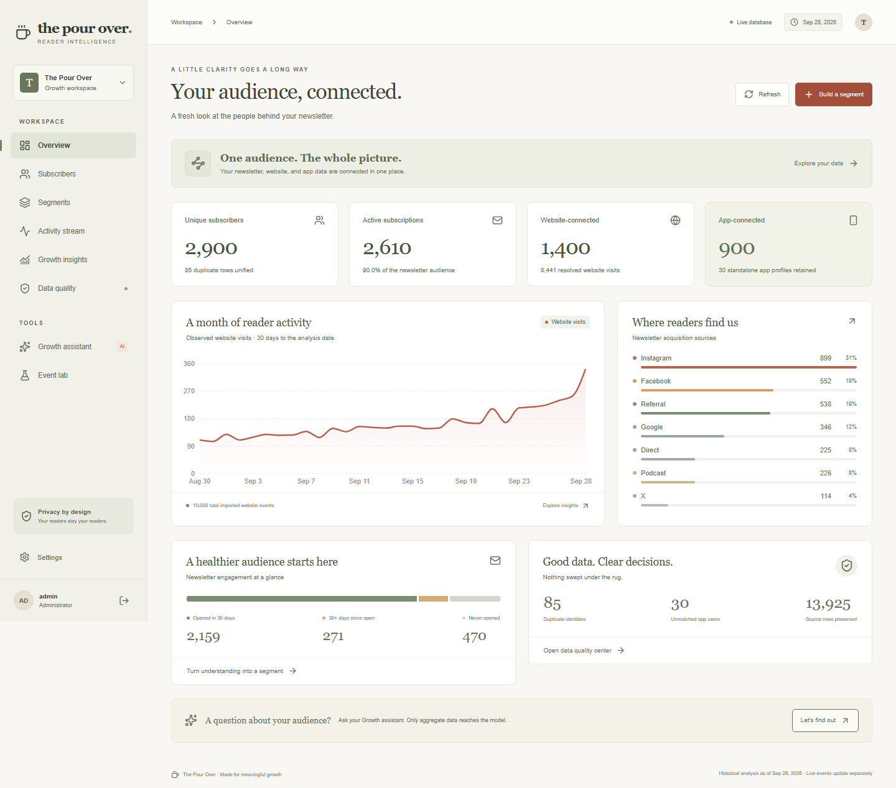

# The Pour Over · Reader Intelligence

A working mini customer data platform for the Growth team: preserved CSV source records, unified reader profiles, live app events, dynamic segments, acquisition insights and a privacy-constrained Azure AI assistant.

Assessment demo: Azure hosting is limited to **14 days, ending October 29, 2026**. The approved target is approximately **US$30/month**; the selected fixed hosting estimate is US$28.50/month before light inference, network usage and taxes. The dedicated demo resources are scheduled for removal on October 29 at 12:00 IST. See [deployment and cleanup](docs/DEPLOYMENT.md) for live acceptance status, exact inventory and cost limits.



## Run locally

Node.js 24 and npm are required. No Docker or database installation is necessary for the local PostgreSQL engine.

```sh
npm ci
npm run setup
npm run import
npm run dev
```

Open [localhost:3000](http://localhost:3000). The setup command creates ignored `.env` and `.local-access.txt` files. Read the latter for your generated administrator login. No shared default password is committed.

The three synthetic assessment CSVs are included in `data/`. Importing the same file twice is a no-op, and source rows are never discarded. For different files: `npm run import -- /path/to/csv-directory`. Import from CLI while the local app is stopped; PGlite supports one owning process. The authenticated Settings importer works while the app is running. Import subscribers before app users and web events.

## What works

- Overview from real data: 2,900 canonical newsletter identities, 10,000 website visits, 8,441 resolved visits and 900 linked app accounts. These are source verification results, not constants used by the dashboard.
- Search by email, profile ID, app user ID, visitor ID or source. Subscriber 360 includes newsletter snapshots, website/app chronology, identity links and original source rows.
- Raw duplicate preservation, invalid/blank record flags, unmatched app accounts and anonymous visitor coverage.
- AND/OR segments with newsletter/all-profile scope, previews, save/edit/delete, current membership and formula-safe authorized CSV export.
- HMAC-protected `POST /webhooks/app`: persisted idempotency, conflicting duplicate rejection, event-time ordering, unknown users and safe anonymous device backfill.
- Isolated Event Lab for actual signed deliveries, duplicate retries and out-of-order demonstrations.
- Acquisition comparisons, signup cohorts, transparent engagement scoring and observed channel relationships.

- Azure AI aggregate answers and structured segment proposals. User text is projected to an approved intent before inference; source PII and raw messages never enter model requests. Missing configuration returns an explicit unavailable state.

The workspace is organized into feature components and scoped CSS Modules, with an authenticated server layout and a persistent navigation shell. [Architecture findings and verification](docs/REFACTOR_REVIEW.md) describe the changes and limits. [Development responsibilities](docs/DEVELOPMENT_PROCESS.md) distinguish human engineering direction and developer-reported review/testing from AI-generated implementation and recorded automated execution. The original raw self-audit is preserved.

## Architecture and environment

One full-stack Next.js 16 application, React 19, strict TypeScript, Zod, parameterized SQL, PostgreSQL/PGlite, iron-session, Recharts, Lucide and a custom responsive CSS system. Business logic is in `src/lib`; authenticated APIs and the exact webhook path are Next.js route handlers.

| Variable | Purpose |
|---|---|
| `APP_URL` | Exact public origin; also used for server-to-server Event Lab deliveries |
| `SESSION_SECRET` | At least 32 random characters; encrypts eight-hour sessions |
| `ADMIN_USERNAME`, `ADMIN_PASSWORD_HASH` | Admin login; hash is `salt:scrypt(password,salt,64).hex` |
| `ANALYST_USERNAME`, `ANALYST_PASSWORD_HASH` | Optional analyst credentials; cannot import or use Event Lab |
| `WEBHOOK_SECRET` | At least 32 random characters; shared with the app-event sender |
| `ANALYSIS_DATE` | Historical reference date; defaults to `2026-09-28` |
| `DATABASE_URL` | PostgreSQL URL for hosted production, with verified TLS |
| `PGLITE_PATH` | Optional local persistent database directory; default `.data/postgres` |
| `AZURE_AI_ENDPOINT` | Azure OpenAI-compatible resource endpoint, without `/openai/v1` |
| `AZURE_AI_DEPLOYMENT`, `AZURE_AI_KEY` | Existing approved Foundry deployment and server-only credential |

See `.env.example`. Production refuses the embedded database fallback. Local AI configuration is optional for startup; a live assistant requires the three Azure AI variables. The standard [Azure OpenAI v1 Chat Completions endpoint](https://learn.microsoft.com/en-us/azure/foundry/openai/latest) is used server-side.

## Webhook protocol

Send JSON with `event_id`, `event` (`app_open`, `read_story`, `link_click`, `login`), nullable `user_id`, `device_id`, ISO timestamp and bounded scalar `properties`. Login requires a user ID.

Headers:

```text
Content-Type: application/json
X-TPO-Timestamp: <current Unix seconds>
X-TPO-Signature: sha256=<hex HMAC-SHA256(secret, timestamp + '.' + raw JSON body)>
```

Keep the exact body bytes used for signing. Signing time is actual wall-clock time, independent of the historical event time. Requests outside five minutes are rejected. Identical retries return 200 and `duplicate:true`; new events return 201; conflicting reuse returns 409. The database, not process memory, enforces uniqueness. `test_` event IDs reserve an isolated namespace requiring `test_` device and user IDs.

```sh
npm run webhook:send -- /path/to/event.json
```

Without a file the sender creates a clearly named demonstration event and standalone demo user, which changes live app analytics. Prefer Event Lab when you want isolated test traffic.

## Verification

```sh
npm run typecheck
npm run lint
npm test
npx playwright install chromium
npm run test:e2e
npm run build
npm audit
```

To check a locally running optimized release with the configured real Azure model: `node node_modules/@playwright/test/cli.js test --config playwright.release.config.ts`. This optional check makes a live inference request and writes the actual screenshots under `docs/`. After a local build, set `ALLOW_LOCAL_DB=1` before `npm start` only when testing the embedded database in production mode; leave this override unset in hosted production. `node scripts/check-release.mjs` checks release artifacts for configured secret values.

Tests load the supplied datasets into isolated PostgreSQL engines. Browser tests use port 43187 and their own database, with no Azure inference charges; the unavailable-model UI is intentionally tested. `npx tsx scripts/smoke.ts` exercises the local configured live Azure connection and saves a safe aggregate result. Automated checks, observed results and remaining limits are recorded in [docs/VERIFICATION.md](docs/VERIFICATION.md).

## Hosting and submission

Azure App Service + PostgreSQL Flexible Server configuration is in `infra/main.bicep`, with an unprivileged optional Docker runtime. [Deployment instructions](docs/DEPLOYMENT.md) cover migration, secrets, IP allowlisting, packaging and verification. Creating billable Azure services requires explicit cost approval; no public hosted URL is claimed until deployed and checked. Linux must build the hosted release bundle; Windows standalone junctions are not portable.

[Architecture decisions](docs/ARCHITECTURE.md), [security and privacy](docs/SECURITY.md), [data dictionary](docs/DATA_DICTIONARY.md), [raw self-audit](docs/SELF_AUDIT.md), and [Loom recording plan](docs/LOOM_PLAN.md) document the submission. The recording itself still needs to be made.

Known limits: fixed safe AI intents rather than unrestricted natural-language SQL; snapshot data cannot measure historical open transitions or true retention; shared devices are deliberately under-linked; staff authentication has no MFA/per-session revocation; production PostgreSQL and Azure hosting require separate deployment verification. There are no fabricated app events or inferred newsletter-open timelines in the initial dataset.
